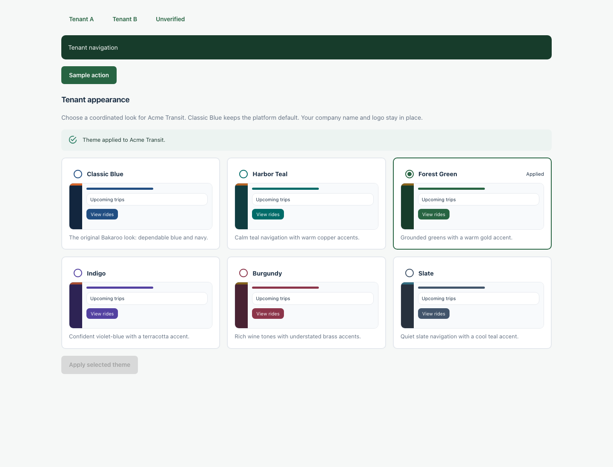

# Tenant appearance presets

Tenants can keep the default appearance or opt into one of six coordinated palettes. Logos, company names, welcome text, and footer settings continue to use the existing tenant identity settings.

| Theme | Primary | Navigation | Accent |
| --- | --- | --- | --- |
| Classic Blue (default) | `#214e82` | `#12263e` | `#d8662a` |
| Harbor Teal | `#006b68` | `#103c40` | `#b66324` |
| Forest Green | `#276442` | `#173c2b` | `#8b641c` |
| Indigo | `#5341a1` | `#2d2354` | `#a84e32` |
| Burgundy | `#8c354a` | `#492333` | `#84621c` |
| Slate | `#42556b` | `#27313d` | `#326d80` |

## Choosing and applying

- Platform admin: **Tenants → Tenant appearance** (palette icon on the selected tenant).
- Tenant admin: **Company Settings → Tenant appearance**.
- Preview the cards, select a theme, then choose **Apply selected theme**. Selecting a radio option alone does not save anything.
- Application is permitted only when the tenant is **ACTIVE** and its existing transport-compliance verification status is **VERIFIED**. The catalog can be previewed beforehand, with application disabled and an explanation.
- Choose Classic Blue and apply it to return to the platform palette. This clears only the color overrides; the tenant's logo and identity fields are retained.
- Existing custom palettes remain active until explicitly replaced. The picker labels them as existing custom colors.

The backend owns the preset catalog. Unknown codes are rejected. Platform admins can target a tenant; tenant admins can modify only their own tenant. Theme changes are audited. General company-settings updates cannot overwrite the palette or bypass verification: palette changes use the dedicated theme endpoints.

## Runtime behavior

The existing `primary_color`, `secondary_color`, and `accent_color` settings hold the selected palette. No schema migration is required. The selected code is derived from those colors; legacy unmatched colors are shown as `CUSTOM`.

The authenticated web app derives primary tones, navigation, selected items, focus accents, and soft backgrounds from tenant branding. Theme updates made by the current tenant admin are applied immediately. Other visible web sessions refresh capabilities every minute and on window focus. Transient background network/server failures retain the last successful branding; access denials clear tenant capabilities.

Mobile resolves branding per tenant and account, using the existing tenant-scoped branding cache for offline startup. Paper controls, shared buttons/inputs/headers, role command decks and active tab colors consume the palette. It refreshes every minute and when the app becomes active. Sign-out returns to the platform palette. Status colors retain their operational meaning across all themes.

The public marketing site and platform administrator workspace retain their own appearance. Applying a theme to a tenant does not theme the platform administrator's workspace or another tenant.

## Endpoints

- `GET` / `PUT /company/branding-theme`: tenant administrators, current tenant only.
- `GET` / `PUT /platform/tenants/{tenantId}/branding-theme`: platform administrators.
- PUT body: `{ "themeCode": "FOREST" }` (or another catalog code).

## Validation and release

- Backend verification: **227 tests passed**, including MySQL persistence/isolation and reset, authorization, verification gating, unknown-code rejection, and protection against generic-settings bypass.
- Web: **38 tests passed**, including preview/apply/reset, verification lock, palette resolution, background refresh failure and access-denial handling.
- Mobile: **35 tests passed**, including account switching, default reset, invalid-color fallback and shared-token isolation; TypeScript checking passed.
- Each preset's primary and navigation colors have at least **4.5:1 contrast with white text**, verified in tests. Accent colors are used as accents rather than small white-text backgrounds.
- Local browser checks passed for all six previews, staged selection, apply/reset, independent tenants, verification gating and widths from 320px to desktop. Preview data was synthetic.

Deploy backend and web changes together. Older clients should use the dedicated theme API rather than submitting changed raw palette values through general company settings. The mobile client must be updated to receive the new shared-component theme behavior. No deployment or physical-device acceptance test is performed by the implementation itself.

Android sideload build: `mobile/artifacts/transport-platform-1.0.0-arm64-themes-2026-11-08.apk` (ARM64, Android 7.0+, existing test signing key, production API). APK signature and embedded app bundle were verified.
